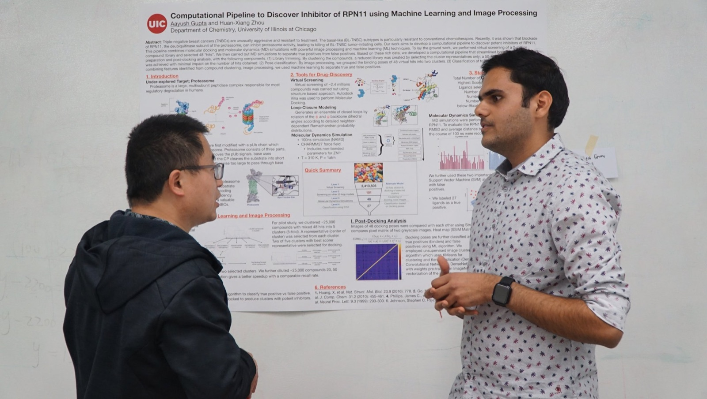

  <section class="hero-panel hero-panel--immersive">
    

      
      

        AI for molecular design
        Boston · Vida Vinci
      

    

    

      

        AI for Science
        Computational Chemistry
        Drug Discovery
      

      

        <h1 class="hero-title">Aayush Gupta</h1>
        
Scientist II, Machine Learning at Vida Vinci

      

      
I build machine learning and computational chemistry systems for drug discovery — spanning peptide modalities, protein binder design, molecular simulation, ADME prediction, and high-throughput screening. My work sits between chemistry, physics, and AI.

      

        <a class="button-link button-link--primary" href="/cv/">View CV</a>
        <a class="button-link button-link--accent" href="/research/">Explore Experience</a>
        <a class="button-link" href="https://www.linkedin.com/in/aaayushg">LinkedIn</a>
        <a class="button-link" href="https://github.com/aaayushg">GitHub</a>
      

      <ul class="hero-facts">
        <li>10+ years across academia &amp; industry</li>
        <li>AI/ML, molecular simulation &amp; cheminformatics</li>
        <li>PhD in Computational Chemistry, UIC</li>
      </ul>
    

  </section>

  <section class="section-band reveal">
    
Snapshot

    

      

        3
        Industry roles across Vida Vinci, DeepCure, and Exscientia
      

      

        5+
        Publications and preprints in AI-driven computational chemistry
      

      

        300×
        Speedup delivered in high-throughput MD screening at DeepCure
      

    

  </section>

  <section class="grid-panels">
    <article class="section-card reveal">
      
Current Focus

      <h2>Building practical AI for molecular decisions</h2>
      
I focus on systems that help scientists rank, design, and test molecules with more confidence — ML-based molecular representations, protein binder design workflows, simulation pipelines, uncertainty-aware selection strategies, and production research tooling.

      

        Machine Learning
        Computational Chemistry
        Cheminformatics
        Protein Design
        Molecular Dynamics
        ADME Modeling
      

    </article>

    <article class="section-card reveal">
      
Career Arc

      <h2>From physics-grounded chemistry to product-minded AI</h2>
      
My path runs from quantum chemistry and molecular modeling to production-facing machine learning for biotech. I have worked across research-heavy environments and fast-moving startup teams.

      

        <a href="https://scholar.google.com/citations?user=DwxU1sYAAAAJ&hl=en">Google Scholar</a>
        <a href="mailto:aayush.ict@gmail.com">aayush.ict@gmail.com</a>
        <a href="https://aaayushg.github.io/files/Aayush_Resume.pdf">Download resume</a>
      

    </article>
  </section>

  <section class="section-card reveal">
    
Selected Highlights

    <h2>Work I am proud of</h2>
    

      

        

          Vida Vinci
          Scientist II, Machine Learning · Jul 2025 – present
        

        <ul class="note-list">
          <li>Built ML-cheminformatics encoder representations for novel peptide modalities and predictive ADME models grounded in experimental data.</li>
          <li>Worked on de novo protein drug binder design, Free-Wilson analysis, and uncertainty-aware compound ranking.</li>
          <li>Implemented BIBD and CP-SAT based library design workflows for synthesis-ready candidate generation.</li>
        </ul>
      

      

        

          DeepCure
          Senior Scientist, Computational Chemistry · Nov 2023 – May 2025
        

        <ul class="note-list">
          <li>Built an end-to-end OpenMM MD + ABFE/RBFE pipeline with in-house Amber preparation.</li>
          <li>Engineered a high-throughput MD screening technique with ~300× speedup.</li>
          <li>Improved internal AI and computational chemistry platforms.</li>
        </ul>
      

      

        

          Exscientia
          AI Research Scientist · Mar 2022 – Nov 2023
        

        <ul class="note-list">
          <li>Bridged medicinal chemistry and ML teams on ADMET, active learning, and linker-generation workflows.</li>
          <li>Led work within the PhysicsML team and contributed to EXS-NNP.</li>
          <li>Helped turn high-impact modeling work into usable internal product capability.</li>
        </ul>
      

    

  </section>

  <section class="grid-panels">
    <article class="section-card reveal">
      
Education

      <h2>Training</h2>
      

        

          

            University of Illinois at Chicago
            PhD, Computational Chemistry · MS, Chemistry
          

          
Doctoral work under Prof. Huan-Xiang Zhou focused on machine learning methods for advancing computational chemistry.

        

        

          

            Institute of Chemical Technology, Mumbai
            BTech, Chemical Technology
          

          
Built the early foundation in chemistry, materials, simulation, and research.

        

      

    </article>

    <article class="section-card reveal">
      
Research Theme

      <h2>Where my work creates leverage</h2>
      <ul class="note-list">
        <li>Turning advanced scientific methods into workflows that research teams can actually use.</li>
        <li>Connecting statistical learning with physics-based simulation.</li>
        <li>Designing decision systems that help rank compounds and understand uncertainty.</li>
        <li>Working across code, experiments, and multidisciplinary teams.</li>
      </ul>
    </article>
  </section>

